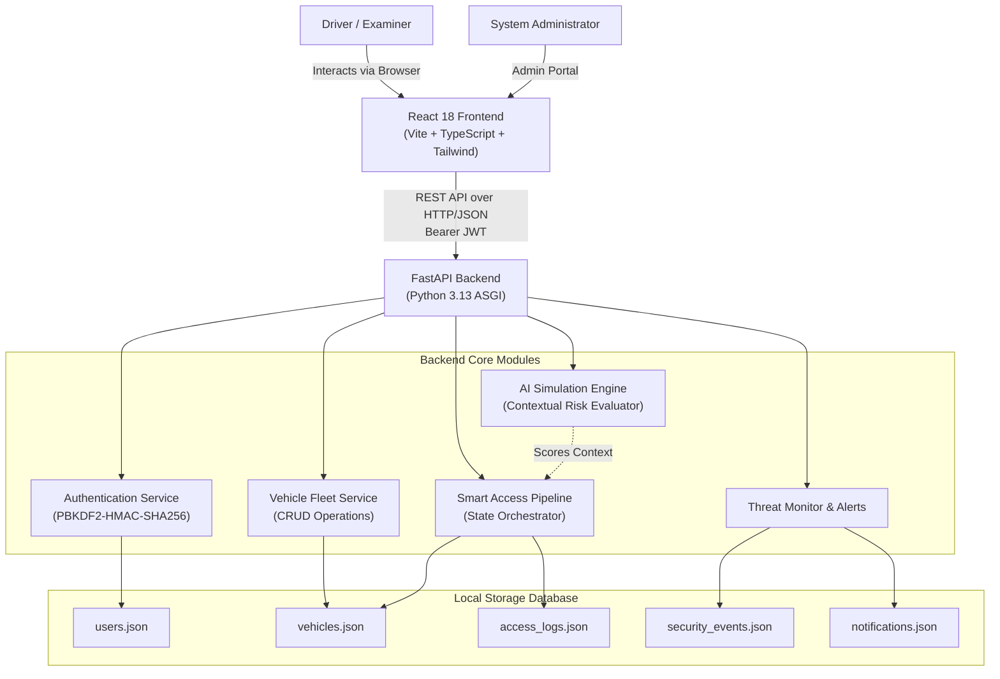
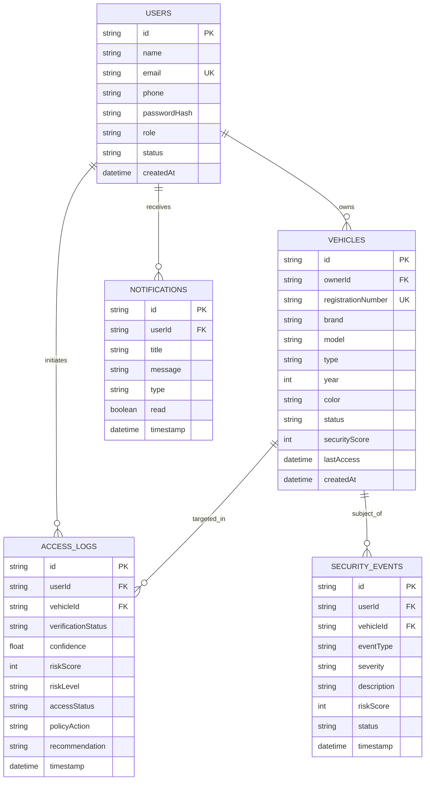
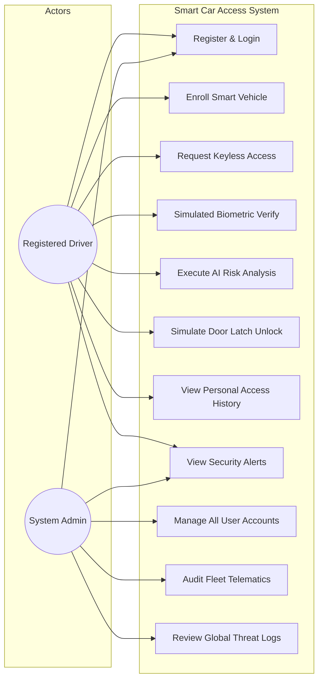
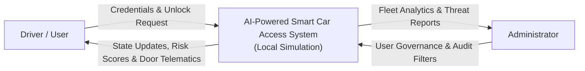
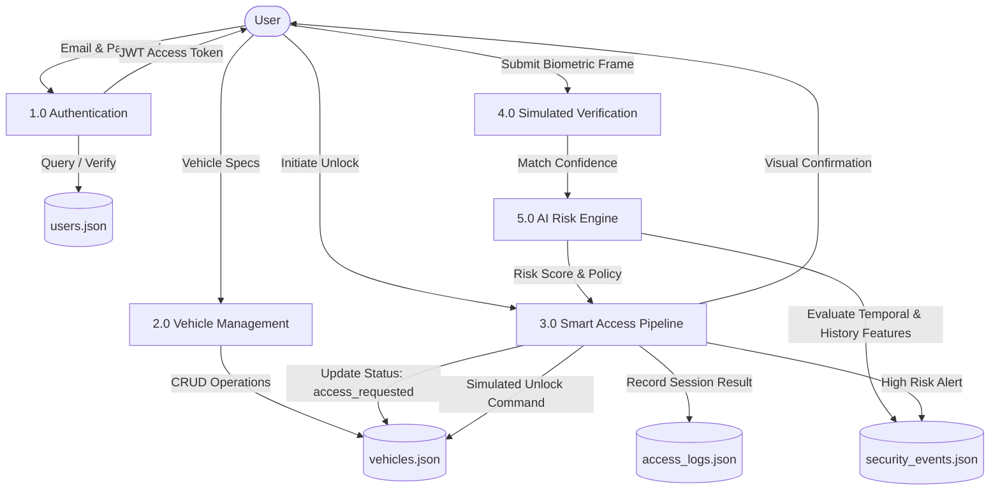
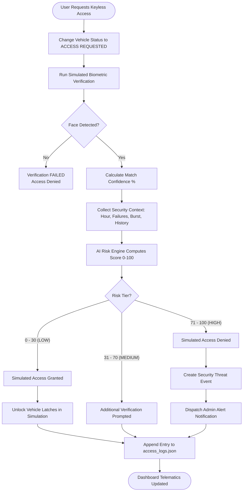

# Visual System Diagrams (Mermaid-Compatible)

## 1. System Architecture Diagram

---

## 2. Entity-Relationship (ER) Diagram

---

## 3. Use Case Diagram

---

## 4. Data Flow Diagram — Level 0 (Context Level)

---

## 5. Data Flow Diagram — Level 1

---

## 6. Access Control Flowchart

